# Cmathtuts: A Collection of Math Tutorials in C

> **Note:** The [`dev` branch](https://github.com/Foadsf/Cmathtuts/tree/dev) contains the most organized and up-to-date content.

## Introduction

When I started doing linear algebra in C, I was surprised to find so few tutorials for **BLAS**, **LAPACK**, and other fundamental APIs, despite the fact that they are the building blocks of many scientific computing libraries. For that reason, I started collecting all the examples and tutorials I could find across the internet.

This repository covers:

- **BLAS** (Basic Linear Algebra Subprograms)
- **CBLAS** (C interface to BLAS)
- **LAPACK** (Linear Algebra PACKage)
- **CLAPACK** (C interface to LAPACK)
- **LAPACKE** (C interface to LAPACK, newer standard)
- **ATLAS** (Automatically Tuned Linear Algebra Software)
- **OpenBLAS** (Optimized BLAS library)

I should warn you that as a mechanical engineer, I had little experience managing a git repository when I started this project. If you manage to get past the somewhat messy structure, you'll find a wealth of examples and instructions that might help you.

## Background: Understanding BLAS, LAPACK, and Their Implementations

This repository was created in response to [a Stack Overflow question](https://stackoverflow.com/a/42212642/4999991) I answered about the relationship between these libraries:

**BLAS** and **LAPACK** are not specific SDKs—they are *specifications* or *language extensions* rather than implementations or libraries. The original implementations by [Netlib](http://www.netlib.org/) were written in **FORTRAN 77**, which is why you'll see some strange conventions when using these APIs: you're actually calling FORTRAN routines in C.

Some of the best implementations of BLAS and LAPACK include:

- **ATLAS** and **OpenBLAS** — High-performance CPU implementations conforming to the original API, implemented in C/C++ from scratch
- **GPGPU implementations** using OpenCL: [CLBlast](https://github.com/CNugteren/CLBlast), [clBLAS](https://github.com/clMathLibraries/clBLAS), [clMAGMA](https://icl.utk.edu/magma/), [ArrayFire](https://arrayfire.com/), and [ViennaCL](http://viennacl.sourceforge.net/)
- Vendor-specific implementations optimized for specific hardware (Intel MKL, cuBLAS, etc.)

My recommendation to anyone who wants to learn using BLAS and LAPACK in C is to learn **FORTRAN-C mixed programming** first. The first chapter of this repository is dedicated to this matter, with many different examples.

## What's Included

- **Makefiles** you can study to learn how to call individual Fortran routines in C or C++ programs
- Examples modified to compile with **GNU compilers** (`gcc`, `g++`, and `gfortran`)
- Installation instructions for **macOS** and **Linux**
- **Bash scripts** (`.sh`) for automatic compilation of some libraries
- Fortran-C mixed programming examples

## Repository History

This project has evolved over nearly a decade (2016–2025). Here's a visualization of the git history:

```mermaid
gitGraph
   commit id: "3717a6d"
   commit id: "a4fa578"
   commit id: "19e4b80"
   commit id: "3616e1c"
   commit id: "2ed5943"
   commit id: "cc4cd0d"
   commit id: "540f2eb"
   commit id: "0b1c735"
   commit id: "3515e2a"
   commit id: "f1294c1"
   commit id: "4594bb2"
   commit id: "32aca00"
   commit id: "d83be81"
   commit id: "b3764b8"
   commit id: "f833803"
   commit id: "ae2814e"
   branch dev
   checkout dev
   commit id: "4847fa7"
   commit id: "b91ea59"
   checkout main
   commit id: "12c5ce4"
   checkout dev
   commit id: "328dc65"
   commit id: "076360e"
   commit id: "63aa6d8"
   commit id: "7401dcd"
   branch dev-remote
   commit id: "10a32cf"
   commit id: "277badd"
   checkout dev
   commit id: "bf89b2d"
   merge dev-remote id: "cbb75e7"
   commit id: "9f3b7ad"
   commit id: "8fc1f22"
   commit id: "e67541a"
   commit id: "7448b6b"
   branch dev-remote-2
   commit id: "ff7ebb1"
   commit id: "ff246b5"
   checkout dev
   commit id: "c4c4020"
   merge dev-remote-2 id: "0a58ab8"
   commit id: "5af3dba"
   commit id: "6581371"
   commit id: "8503557"
   commit id: "0b611d7"
   commit id: "7fc2de0"
   commit id: "e991a92"
   commit id: "c1917c5"
   commit id: "4b222e0"
   commit id: "4cb6cf4"
   commit id: "a5af85a"
   commit id: "403bf5d" tag: "origin/dev"
   checkout main
   merge dev id: "76acde4"
   commit id: "6894fd1"
   commit id: "a361050" tag: "master"
```

### Evolution Timeline

**2016: Inception and Foundations**
- Initial commit with repository name correction to "Cmathtuts"
- Added Jochen Voss examples from [seehuhn.de/pages/linear](http://www.seehuhn.de/pages/linear)
- Successfully compiled BLAS on macOS X
- Added CLAPACK examples and created Makefiles for BLAS examples
- Successfully compiled LAPACK, CBLAS, and LAPACKE
- Created Makefiles for BLAS, CBLAS, CLAPACK, LAPACK (LAPACKE had issues)
- Added Netlib BLAS bash script for compilation and installation
- Major expansion: **Fortran-C mixed programming** examples added
- Repository cleanup: binary files removed using [BFG Repo-Cleaner](https://rtyley.github.io/bfg-repo-cleaner/)

**2017: Cleanup and Reorganization**
- Further cleanup and folder restructuring
- Updated README documentation
- Branches diverged: `master` for stable releases, `dev` for active development

**2018: Major Development on `dev` Branch**
- Explained FORTRAN concepts (`write`/`format` commands, `common` blocks)
- Added `.gitignore` for swap files and compiled objects
- Renamed folders to standardized format (`Ex01`, `Ex02`, etc.)
- Fixed platform-specific issues (`apt-get install` commands for Linux)
- Clarified library distinctions ("this is LAPACK not BLAS")
- Added multiple new examples (Ex25, Ex26)

**2019–2021: Maintenance**
- Updated README on master branch
- Added GitHub Sponsors funding configuration
- Minor edits and improvements

## Known Issues

1. Unable to compile ATLAS on macOS X — a [bug report](https://sourceforge.net/p/math-atlas/bugs/261/) was submitted on SourceForge
2. For some BLAS and CBLAS examples, `-lgfortran` is required to compile. On macOS X, you need to install gfortran and link against `libgfortran.dylib`

## TODO

- [ ] Create compilation/installation scripts for all libraries across different platforms
- [ ] Test Makefiles on other platforms (currently only tested on macOS X)
- [ ] Merge improvements from `dev` branch into `master`
- [ ] Add Windows compilation instructions

## Resources and References

### Official Documentation
1. [Netlib BLAS](http://www.netlib.org/blas/)
2. [Netlib LAPACK](http://www.netlib.org/lapack/)
3. [LAPACKE Documentation](ftp://ftp.icm.edu.pl/packages/netlib/lapack/lapacke.txt)

### Tutorials and Examples
4. [Oregon State - LAPACK C Programming](http://physics.oregonstate.edu/~landaur/nacphy/lapack/cprogp.html)
5. [FSU - CLAPACK Examples](https://people.sc.fsu.edu/~jburkardt/c_src/clapack/clapack.html)
6. [UCSC Pleiades - LAPACK](https://pleiades.ucsc.edu/hyades/LAPACK)
7. [UCSC Pleiades - BLAS](https://pleiades.ucsc.edu/hyades/BLAS)
8. [Intel MKL LAPACK Examples](https://software.intel.com/sites/products/documentation/doclib/mkl_sa/11/mkl_lapack_examples/index.htm)

### Stack Overflow Discussions
9. [How to call CLAPACK from C](http://stackoverflow.com/questions/22085277/how-to-call-clapack-from-c)
10. [Relation between BLAS, LAPACK, and ATLAS](http://stackoverflow.com/questions/17858104/what-is-the-relation-between-blas-lapack-and-atlas/17858345)
11. [How does BLAS get such extreme performance](http://stackoverflow.com/questions/1303182/how-does-blas-get-such-extreme-performance/11421344)
12. [Most widely used C++ vector/matrix libraries](http://stackoverflow.com/questions/1380371/what-are-the-most-widely-used-c-vector-matrix-math-linear-algebra-libraries-a/1452950)
13. [Purpose of LDA argument in BLAS dgemm](http://stackoverflow.com/questions/8206563/purpose-of-lda-argument-in-blas-dgemm/8209290)
14. [Replicating BLAS matrix multiplication performance](http://stackoverflow.com/questions/24071622/replicating-blas-matrix-multiplication-performance-can-i-match-it)

### Additional Libraries
15. [Cephes Mathematical Library](http://www.netlib.org/cephes/)
16. [CRlibm - Correctly Rounded Mathematical Library](http://lipforge.ens-lyon.fr/www/crlibm/index.html)

### Build Guides
17. [Compiling LAPACK as shared library in Linux](http://theoryno3.blogspot.nl/2010/12/compiling-lapack-as-shared-library-in.html)
18. [Linux Questions - Scientific Libraries Installation](http://www.linuxquestions.org/linux/answers/programming/installation_and_use_common_scientific_libraries_unix_part_2_lapack_and_its_wrappers_lapacke_and_atlas)

## Support This Project

If you find this repository helpful, please consider:

- ⭐ **Starring** the repository
- 🍴 **Forking** and contributing improvements
- 💖 **Sponsoring** via [GitHub Sponsors](https://github.com/sponsors/Foadsf) or [Patreon](https://www.patreon.com/user?u=4281332)

## License

This repository contains examples collected from various sources across the internet. Individual examples may have their own licenses. Please check the source references for specific licensing information.

## Author

**Dr. Foad Sojoodi Farimani**
- GitHub: [@Foadsf](https://github.com/Foadsf)
- Stack Overflow: [Foad S. Farimani](https://stackoverflow.com/users/4999991/foad-s-farimani)
- Twitter: [fsfarimani](https://x.com/fsfarimani)
- LinkedIn: [fsfarimani](https://www.linkedin.com/in/fsfarimani/)